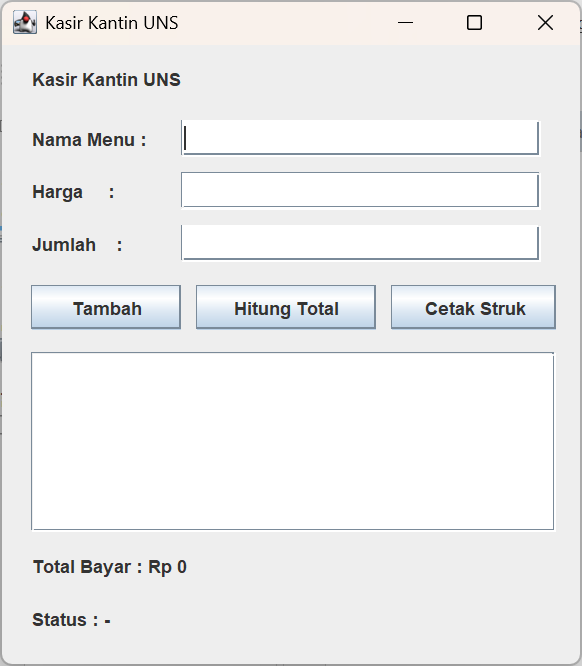
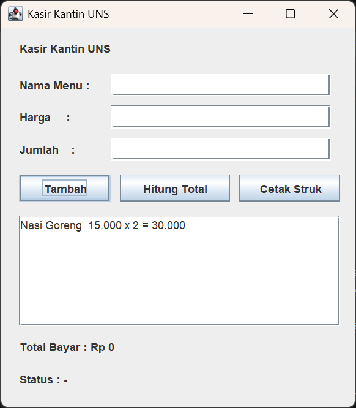
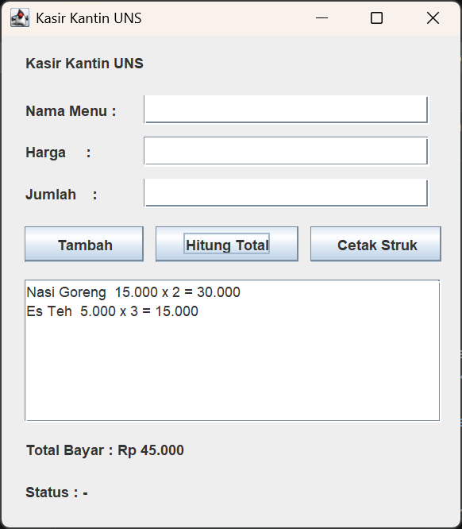
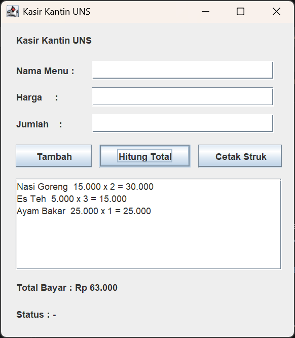

**Deskripsi Program**


Kasir Kantin UNS adalah aplikasi yang dibuat dengan bahasa Java untuk membantu kasir kantin kampus mencatat pesanan dan menghitung total bayar. Program ini menyelesaikan permasalahan sederhana yang sering dihadapi kantin, yaitu kasir yang masih memakai program console yang lambat dan rawan salah ketik, perhitungan diskon yang dilakukan manual, serta aplikasi yang macet saat ada proses yang memakan waktu. Aplikasi ini dikerjakan bertahap dalam empat tahap pada praktikum PBO Kelas 3B (Pertemuan 11 Multithreading dan Pertemuan 12 GUI Programming), dan seluruh class berada dalam satu package `lab.kasir`.

Kasir dapat memasukkan nama menu, harga, dan jumlah lewat jendela Java Swing, menambahkannya ke struk, menghitung total bayar (dengan diskon 10 persen jika subtotal lebih dari Rp50.000), dan mencetak struk. Program juga memuat simulasi dua kasir (Dina dan Eko) yang melayani pelanggan bersamaan, dijalankan lewat program console `MainKasir`. Program memvalidasi input, misalnya menolak field yang kosong dan menangani harga atau jumlah yang bukan angka tanpa membuat program berhenti. Semua data disimpan di memori selama program berjalan (tidak memakai database atau file). Program ini menerapkan konsep yang diminta pada Pertemuan 11 dan 12:

* Encapsulation: atribut seperti `subtotal`, `nama`, dan seluruh komponen GUI dibuat private, dan hanya diakses lewat method seperti `tambahItem()`, `getSubtotal()`, `hitungTotal()`, dan `reset()`.
* Inheritance: `Kasir` memakai `extends Thread` dan `KasirFrame` memakai `extends JFrame`, sehingga keduanya mewarisi kemampuan class induknya.
* Multithreading: dua kasir berjalan sebagai thread terpisah yang dimulai dengan `start()`, dan `join()` dipakai agar `main` menunggu keduanya selesai. Tombol Cetak Struk juga memakai thread baru supaya jendela tidak macet.
* GUI Programming: jendela dibuat dengan `JFrame`, `JLabel`, `JTextField`, `JButton`, `JTextArea` di dalam `JScrollPane`, dengan posisi diatur manual memakai `setLayout(null)` dan `setBounds()`.
* Event Handling: setiap tombol memakai `addActionListener()` dengan lambda.
* Exception Handling: `NumberFormatException` ditangkap dengan try-catch pada input harga dan jumlah, dan `InterruptedException` ditangkap pada `Thread.sleep()`.
* Pemisahan logika dan tampilan: class `Pesanan` tidak berisi kode GUI sama sekali. `KasirFrame` hanya memanggil method `Pesanan` dan tidak menghitung sendiri.


**Fitur**

|Tahap|Fungsi|
|-|-|
|1|Hitung subtotal dan total pesanan, diskon 10% jika subtotal lebih dari Rp50.000, serta reset pesanan|
|2|Simulasi dua kasir (Dina dan Eko) sebagai thread yang melayani pelanggan bersamaan|
|3|Form kasir: input nama menu, harga, jumlah, tombol Tambah, tombol Hitung Total, area struk, dan label total bayar|
|3|Validasi input: field kosong dan harga/jumlah bukan angka menampilkan pesan lewat JOptionPane|
|4|Tombol Cetak Struk dengan label status "Mencetak struk..." lalu "Struk selesai" setelah 2 detik, tanpa membuat jendela macet|


**Struktur Class**

|File|Jenis|Keterangan|
|-|-|-|
|Pesanan.java|Class logika|Atribut private subtotal, method tambahItem(), getSubtotal(), hitungTotal(), reset()|
|Kasir.java|Subclass dari Thread|Mencetak "Kasir <nama> melayani pelanggan ke-*" untuk 5 pelanggan, jeda 500 ms*|
|MainKasir.java|Class utama (console)|Menguji Pesanan (Tahap 1) dan menjalankan dua Kasir dengan start() dan join() (Tahap 2)|
|KasirFrame.java|Subclass dari JFrame|Tampilan GUI, event tombol, validasi, dan thread cetak struk (Tahap 3 dan 4)|
|MainGUI.java|Class utama (GUI)|Membuka KasirFrame di Event Dispatch Thread|


**Cara Menjalankan**

Jalankan dari folder `kasir/`.

```bash
# kompilasi semua class
javac -d out src/lab/kasir/\*.java

# Tahap 1 dan 2 (console)
java -cp out lab.kasir.MainKasir

# Tahap 3 dan 4 (jendela GUI)
java -cp out lab.kasir.MainGUI
```

Syarat: JDK 11 atau lebih baru. `MainGUI` membutuhkan layar grafis.


**Penerapan Konsep (dengan Kode)**

1. Encapsulation
Atribut dibuat `private` sehingga tidak bisa diubah langsung dari luar class. Perubahan hanya lewat method yang ditentukan.

```java
public class Pesanan {
    private double subtotal;

    public void tambahItem(double harga, int jumlah) {
        subtotal += harga \* jumlah;
    }

    public double getSubtotal() {
        return subtotal;
    }

    public void reset() {
        subtotal = 0;
    }
}
```

`subtotal` tidak punya setter. Satu-satunya cara mengubahnya adalah lewat `tambahItem()` dan `reset()`, sehingga nilainya selalu konsisten. Komponen GUI di `KasirFrame` juga private:

```java
private JTextField txtMenu, txtHarga, txtJumlah;
private JTextArea areaStruk;
private JLabel lblTotal;
private Pesanan pesanan = new Pesanan();
```

2. Inheritance
Subclass memakai `extends` untuk mewarisi class induk.

```java
public class Kasir extends Thread {
    private String nama;

    public Kasir(String nama) { this.nama = nama; }
}

public class KasirFrame extends JFrame {
    public KasirFrame() {
        super("Kasir Kantin UNS");   // memanggil constructor JFrame
        setSize(400, 450);
    }
}
```

`Kasir` mewarisi `start()` dan `join()` dari `Thread`, sedangkan `KasirFrame` mewarisi `setSize()`, `setLayout()`, `add()`, dan `setVisible()` dari `JFrame` tanpa menulis ulang.
3. Logika bisnis: diskon pada class Pesanan
`hitungTotal()` mengembalikan total bayar. Jika subtotal lebih dari 50.000, diberikan diskon 10 persen.

```java
public double hitungTotal() {
    if (subtotal > 50000) {
        return subtotal - (subtotal \* 0.10);
    }
    return subtotal;
}
```

Dengan data uji: Nasi Goreng 15.000 x 2 dan Es Teh 5.000 x 3 menghasilkan subtotal 45.000 (tidak lebih dari 50.000), sehingga total tetap 45.000. Setelah Ayam Bakar 25.000 x 1 ditambahkan, subtotal menjadi 70.000, diskon 7.000, dan total menjadi 63.000. `getSubtotal()` tetap menampilkan 70.000 (sebelum diskon).
4. Multithreading (Tahap 2)
a) `run()` adalah pekerjaan yang dijalankan thread. Setiap putaran mencetak kalimat lalu tidur 500 ms.

```java
@Override
public void run() {
    for (int i = 1; i <= 5; i++) {
        System.out.println("Kasir " + nama + " melayani pelanggan ke-" + i);
        try { Thread.sleep(500); } catch (InterruptedException e) { return; }
    }
}
```

b) `start()` membuat thread baru, sehingga Dina dan Eko berjalan bersamaan. Memanggil `run()` langsung tidak membuat thread baru.

```java
Kasir dina = new Kasir("Dina");
Kasir eko = new Kasir("Eko");
dina.start();
eko.start();
```

c) `join()` membuat `main` menunggu thread selesai, sehingga pesan penutup selalu tercetak paling akhir.

```java
try {
    dina.join();
    eko.join();
} catch (InterruptedException e) {
    e.printStackTrace();
}
System.out.println("Semua pelanggan selesai dilayani");
```

Urutan output Dina dan Eko bisa berbeda tiap dijalankan karena penjadwalan thread diatur oleh JVM dan sistem operasi, bukan oleh program.
5. GUI dengan Java Swing (Tahap 3)
Jendela dibuat dengan layout manual. Setiap komponen diberi posisi dan ukuran lewat `setBounds(x, y, lebar, tinggi)`, lalu ditambahkan dengan `add()`.

```java
setSize(400, 450);
setLayout(null);

txtMenu = new JTextField();
txtMenu.setBounds(120, 50, 240, 25);

btnTambah = new JButton("Tambah");
btnTambah.setBounds(20, 160, 100, 30);

areaStruk = new JTextArea();
areaStruk.setEditable(false);
JScrollPane scroll = new JScrollPane(areaStruk);
scroll.setBounds(20, 205, 350, 120);

setDefaultCloseOperation(EXIT\_ON\_CLOSE);
setVisible(true);
```

`areaStruk` dibungkus `JScrollPane` agar bisa di-scroll saat item banyak, dan dibuat tidak bisa diedit agar struk tidak berubah tanpa sengaja.
6. Event Handling dan Validasi (Tahap 3)
Tombol memakai `addActionListener()` dengan lambda. Tombol Tambah memvalidasi input sebelum memasukkannya ke `Pesanan`.

```java
btnTambah.addActionListener(e -> {
    String menu = txtMenu.getText().trim();
    String hargaStr = txtHarga.getText().trim();
    String jumlahStr = txtJumlah.getText().trim();

    if (menu.isEmpty() || hargaStr.isEmpty() || jumlahStr.isEmpty()) {
        JOptionPane.showMessageDialog(this, "Semua field harus diisi.");
        return;
    }
    try {
        double harga = Double.parseDouble(hargaStr);
        int jumlah = Integer.parseInt(jumlahStr);
        pesanan.tambahItem(harga, jumlah);
        areaStruk.append(menu + "  " + rupiah.format(harga) + " x " + jumlah
                + " = " + rupiah.format(harga \* jumlah) + "\\n");
        txtMenu.setText("");
        txtHarga.setText("");
        txtJumlah.setText("");
    } catch (NumberFormatException ex) {
        JOptionPane.showMessageDialog(this, "Harga dan jumlah harus berupa angka.");
    }
});
```

Jika harga atau jumlah bukan angka, `Double.parseDouble` atau `Integer.parseInt` melempar `NumberFormatException`. Exception itu ditangkap sehingga program menampilkan pesan, bukan berhenti. Tombol Hitung Total hanya meminta hasil dari `Pesanan`:

```java
btnHitung.addActionListener(e ->
        lblTotal.setText("Total Bayar : Rp " + rupiah.format(pesanan.hitungTotal())));
```

`KasirFrame` tidak menghitung sendiri, sehingga logika (di `Pesanan`) dan tampilan (di `KasirFrame`) tetap terpisah.
7. Thread pada GUI: Cetak Struk (Tahap 4)
Semua event Swing berjalan di satu thread khusus bernama Event Dispatch Thread (EDT), yang juga menggambar tampilan. Jika `Thread.sleep(2000)` dipanggil langsung di listener, EDT ikut tertidur dan jendela macet. Karena itu penantian dipindahkan ke thread baru.

```java
btnCetak.addActionListener(e -> {
    new Thread(() -> {
        SwingUtilities.invokeLater(() -> lblStatus.setText("Status : Mencetak struk..."));
        try { Thread.sleep(2000); } catch (InterruptedException ex) { return; }
        SwingUtilities.invokeLater(() -> lblStatus.setText("Status : Struk selesai"));
    }).start();
});
```

Selama 2 detik menunggu, EDT bebas sehingga tombol Tambah dan Hitung Total tetap bisa ditekan. Perubahan label dibungkus `SwingUtilities.invokeLater()` karena komponen Swing tidak aman diubah langsung dari thread lain.


**Output**

Bagian Tahap 1 dan Tahap 2 (console, `MainKasir`) dijalankan dua kali untuk mengamati urutan output kasir.

Percobaan 1:

```text
=== Tahap 1: Uji Pesanan ===
Setelah 2 menu -> subtotal: 45000.0, total: 45000.0
Setelah 3 menu -> subtotal: 70000.0, total: 63000.0
Setelah reset  -> subtotal: 0.0

=== Tahap 2: Dua Kasir ===
Kasir Eko melayani pelanggan ke-1
Kasir Dina melayani pelanggan ke-1
Kasir Dina melayani pelanggan ke-2
Kasir Eko melayani pelanggan ke-2
Kasir Dina melayani pelanggan ke-3
Kasir Eko melayani pelanggan ke-3
Kasir Eko melayani pelanggan ke-4
Kasir Dina melayani pelanggan ke-4
Kasir Dina melayani pelanggan ke-5
Kasir Eko melayani pelanggan ke-5
Semua pelanggan selesai dilayani
```

Percobaan 2 (bagian Tahap 2):

```text
=== Tahap 2: Dua Kasir ===
Kasir Dina melayani pelanggan ke-1
Kasir Eko melayani pelanggan ke-1
Kasir Eko melayani pelanggan ke-2
Kasir Dina melayani pelanggan ke-2
Kasir Dina melayani pelanggan ke-3
Kasir Eko melayani pelanggan ke-3
Kasir Eko melayani pelanggan ke-4
Kasir Dina melayani pelanggan ke-4
Kasir Dina melayani pelanggan ke-5
Kasir Eko melayani pelanggan ke-5
Semua pelanggan selesai dilayani
```

Pengamatan: pada percobaan 1, Eko tampil lebih dulu pada pelanggan ke-1, sedangkan pada percobaan 2 Dina yang tampil lebih dulu. Jadi **urutan output tidak selalu sama**, tetapi kalimat "Semua pelanggan selesai dilayani" **selalu muncul paling akhir** karena `join()`.

Bagian Tahap 3 dan Tahap 4 (GUI, `MainGUI`):

Tampilan awal jendela, total bayar masih Rp 0 dan area struk kosong:



Setelah menu pertama (Nasi Goreng, 15.000 x 2) ditambahkan, satu baris masuk ke area struk dan field dikosongkan. Total bayar masih Rp 0 karena tombol Hitung Total belum ditekan:



Setelah menu kedua (Es Teh, 5.000 x 3) ditambahkan dan Hitung Total ditekan, subtotal 45.000 tidak lebih dari 50.000 sehingga total bayar Rp 45.000 (tanpa diskon):



Setelah menu ketiga (Ayam Bakar, 25.000 x 1) ditambahkan dan Hitung Total ditekan, subtotal menjadi 70.000 sehingga berlaku diskon 10 persen dan total bayar Rp 63.000:

